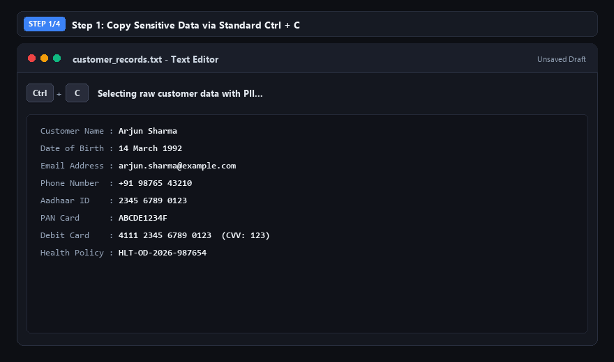

<p align="center">
  
</p>

# Clipboard Masker

**Local-First Desktop Privacy & Real-Time PII Sanitization Engine**

Clipboard Masker is a local-first desktop privacy application designed for Windows. It intercepts clipboard activity, identifies Personally Identifiable Information (PII) and confidential credentials in real time, and sanitizes sensitive data before it can be accidentally pasted into browser windows, AI chat prompts, messaging apps, or public tickets.

Built with Electron, React 18, TypeScript, and Tailwind CSS, Clipboard Masker operates entirely on your workstation without transmitting clipboard data across the network.

<p align="center">
  
</p>

---

## Download & Install

Download the pre-packaged Windows setup installer:

- **Windows Installer (`.exe`):** [Download Clipboard Masker Setup](https://drive.google.com/file/d/1-wCw_pfH_oamAeYcr1iV0VT1322O2Xra/view?usp=sharing)

Run the setup executable on any 64-bit Windows 10/11 system. The model weights and runtime dependencies are fully pre-bundled for complete offline execution with zero configuration required.

---

## Architecture Overview

Clipboard Masker utilizes a high-throughput, two-tier architecture that pairs sub-millisecond in-process deterministic masking with asynchronous local token-classification AI redaction:

```
+-----------------------------------------------------------------------------+
|                                 USER ACTION                                 |
|                       User copies sensitive text (Ctrl + C)                 |
+-----------------------------------------------------------------------------+
                                      |
                                      v
+-----------------------------------------------------------------------------+
|                      CLIPBOARD MONITOR & WRITE-LOCK MUTEX                   |
|  - Anti-feedback loop check via SHA-256 hash ring                          |
|  - Distinguishes user operations from internal programmatic writes          |
+-----------------------------------------------------------------------------+
                                      |
            +-------------------------+-------------------------+
            |                                                   |
            v (Synchronous: < 1ms)                              v (Asynchronous Background: ~200ms)
+---------------------------------------+   +---------------------------------------+
|   TIER 1: DETERMINISTIC ENGINE        |   |    TIER 2: BUNDLED GLINER2-PII AI     |
|  - Luhn checksum (Credit Cards)       |   |  - 205M Bi-Encoder (Zero Refusals)    |
|  - Verhoeff checksum (Indian Aadhaar) |   |  - 42 Native PII entity classes       |
|  - Strict PAN & IFSC regex            |   |  - Contextual person & doctor names   |
|  - URI password & credential parsers  |   |  - Organizations & medical centers    |
|  - UPI handles, salary, & IP tokens   |   |  - Unstructured street/flat addresses |
+---------------------------------------+   +---------------------------------------+
            |                                                   |
            v                                                   v
+---------------------------------------+   +---------------------------------------+
|       IN-MEMORY MASKED COPY           |   |       EXACT SPAN SLICING & STORE      |
|  - Raw text stays on the clipboard    |   |  - Non-destructive character slicing  |
|  - Ctrl + Shift + V pastes masked     |   |  - Zero hallucinations or rephrasing  |
+---------------------------------------+   +---------------------------------------+
```

### Two-Tier Masking Pipeline

1. **Tier 1 (Instant In-Process Pass, < 1ms):**
   When text is copied, Tier 1 instantly validates structured patterns (credit cards with Luhn checksum verification, Indian Aadhaar with Verhoeff checksum algorithm, PAN, IFSC, UPI handles, database URI credentials, emails, passwords, API tokens, SSNs, IPs) in memory and stages the sanitized string for `Ctrl + Shift + V`. The raw text is left on the clipboard, so `Ctrl + V` is never delayed or altered.
2. **Tier 2 (Asynchronous Bundled GLiNER2-PII Pass, ~200ms):**
   Simultaneously, the raw text is dispatched in the background to the bundled GLiNER2-PII model (`fastino/gliner2-privacy-filter-PII-multi`). The model resolves ambiguous entities (unstructured addresses, names, medical facilities, organizations) using character span extraction without conversational safety refusals, refining the staged masked text and the encrypted history.
3. **Anti-Feedback Loop Protection:**
   Programmatic writes to the OS clipboard are registered in a rolling SHA-256 hash ring with an active write lock, preventing infinite event loops.

---

## Core Capabilities

- **Sub-Millisecond Protection:** Guarantees zero latency on user copy-paste workflows.
- **Bundled GLiNER2-PII Intelligence:** Native 42-category PII token classifier captures names, organizations, and unstructured addresses without requiring external daemons.
- **Zero Hallucination Guarantee:** Operates via non-destructive character span slicing, preserving 100% of surrounding punctuation, code, and text formatting.
- **Dedicated Privacy Shortcuts:** Standard `Ctrl + C` leaves raw text untouched in the OS clipboard while staging sanitized text in memory. `Ctrl + Shift + V` pastes the sanitized version and then puts the raw text back, so `Ctrl + V` always pastes raw and you can switch between the two without copying again. `Alt + V` toggles the Quick Clipboard HUD flyout.
- **100% On-Device & Air-Gapped:** Zero cloud calls, zero external background daemons, zero telemetry.
- **Windows System Theme Synchronization:** Seamlessly matches Windows native Dark and Light color modes, styled with Apple Human Interface Guidelines and glassmorphic materials.
- **Authenticated Local Encryption:** History entries are encrypted at rest using AES-256-GCM. An optional Ephemeral Mode keeps raw text strictly in volatile RAM.
- **Dual Window Workflow:**
  - **Quick Flyout (`Alt + V`):** Lightweight popover positioned near the system tray for rapid skimming, unmasking, and single-click retrieval.
  - **Manager Dashboard:** Full dashboard for history search, custom rule definitions, detection statistics, and configuration.

---

## Prerequisites

Before running Clipboard Masker, ensure the following software is installed on your Windows workstation:

1. **Node.js (v20 or higher)**
   - Download from [nodejs.org](https://nodejs.org/) or install via WinGet:
     ```powershell
     winget install OpenJS.NodeJS.LTS
     ```
2. **Python (v3.10 to v3.14)**
   - Required for the local GLiNER2-PII in-process worker:
     ```powershell
     winget install Python.Python.3.14
     pip install "gliner2[local]"
     ```

---

## Local AI Engine & Packaging Architecture

Clipboard Masker is built to operate completely zero-touch for end users:

1. **Pre-Bundled Offline Model (GLiNER2-PII):**
   The production installer packages the weights for `fastino/gliner2-privacy-filter-PII-multi` inside `resources/models/gliner2-pii/`. On first execution, the desktop app launches the worker process immediately with zero network bandwidth or external services required.
2. **Sub-Second Span Slicing:**
   Instead of autoregressive token-by-token generation that takes 40+ seconds on CPU, GLiNER2-PII evaluates text spans in a single forward pass, resolving names, addresses, and organizations in ~200ms.
3. **Zero Safety Refusal Guarantee:**
   Unlike conversational chat models that refuse inputs containing credentials or informal language with phrases like *"I can't help with that"*, GLiNER2 operates purely as a mathematical feature classifier with zero conversational refusals.
4. **Deterministic Redundancy (Tier 1):**
   Structured tokens (Aadhaar with Verhoeff checksums, credit cards with Luhn checksums, PAN, IFSC, UPI handles, and database URI passwords) are instantly redacted in `< 1ms` by the in-process deterministic engine, ensuring zero data leakage.

---

## Installation & Development

### 1. Clone the Repository
```powershell
git clone https://github.com/mastervikramk/Clipboard-masker.git
cd Clipboard-masker
```

### 2. Install Project Dependencies
Install all workspace packages:
```powershell
npm install
```

### 3. Generate App Icons (Optional)
Generate the complete set of vector icons, Windows multi-resolution `.ico` bundles, and system tray assets:
```powershell
npm run icons --workspace=packages/desktop
```

### 4. Rebuild the Paste Helper (Optional)
`keyhelper.exe` sends the `Ctrl + V` keystroke for masked paste. It is committed prebuilt; after editing `resources/engine/keyhelper.cs`, rebuild it with the C# compiler that ships with Windows:
```powershell
npm run keyhelper --workspace=packages/desktop
```

### 5. Start Development Mode
Launch Vite with hot module replacement alongside the Electron main process:
```powershell
npm run dev
```

---

## Production Packaging

To compile, bundle, and generate the standalone Windows installer (`.exe` NSIS and portable builds):

```powershell
npm run build:win
```

### How the Build Process Works:
1. **Icon Generation:** Generates multi-resolution `.ico` and system tray assets.
2. **Model Bundling:** Bundles the `fastino/gliner2-privacy-filter-PII-multi` weights (~1.2 GB) and stdio worker directly into `resources/models/gliner2-pii/` and `resources/engine/` so the application runs completely offline on first launch.
3. **TypeScript Typecheck:** Runs `tsc --noEmit` across all modules.
4. **Vite Bundle:** Compiles React UI and Electron main/preload scripts.
5. **Electron Builder:** Packages the 64-bit NSIS installer and standalone portable executable.

Build outputs are saved to:
```
packages/desktop/release/
  |-- Clipboard Masker Setup 1.0.0.exe      # Recommended: Windows NSIS Setup Wizard
  |-- Clipboard Masker 1.0.0.exe            # Standalone Portable Executable
  |-- win-unpacked/                         # Unpacked binaries (safe to delete)
```

---

## Automated Test Suite

Clipboard Masker includes comprehensive unit tests verifying the anti-loop mutex, regex fallback engine, and encrypted storage operations.

To run tests with Vitest:
```powershell
npm test
```

To run continuous watch testing during development:
```powershell
npm run test:watch --workspace=packages/desktop
```

---

## Keyboard Shortcuts & Navigation

| Shortcut | Context | Action |
|---|---|---|
| `Ctrl + C` | Standard Windows Shortcut | Standard copy (preserves raw text in clipboard, triggers background sanitization) |
| `Ctrl + V` | Standard Windows Shortcut | Standard raw paste (pastes unmasked original text directly from OS clipboard) |
| `Ctrl + Shift + V` | Global Windows Shortcut | Masked paste (pastes sanitized text; the clipboard keeps the raw copy for `Ctrl + V`) |
| `Alt + V` | Global Windows Shortcut | Toggle Quick Clipboard History Flyout (select and copy raw or masked clips) |
| `Escape` | HUD Window | Dismiss Quick Flyout |
| `Enter` | Selected HUD Card | Copy masked text to clipboard |
| `Double Click` | System Tray Icon | Open Manager Dashboard & Settings |
| `Right Click` | System Tray Icon | Open quick action menu (Pause, Resume, Clear, Quit) |

---

## Masking Strategies

Clipboard Masker supports four masking formats, configurable under Settings:

| Strategy | Raw Input | Sanitized Output |
|---|---|---|
| **Tag** (Default) | `john.doe@example.com` | `<EMAIL_ADDRESS>` |
| **Redact** | `john.doe@example.com` | `[REDACTED]` |
| **Asterisk** | `john.doe@example.com` | `j***e@example.com` |
| **Hash** | `john.doe@example.com` | `[#7a8f9b1c]` |

---

## Data Privacy & Storage Specification

- **Zero Outbound Telemetry:** Clipboard content never leaves the local machine. All processing is executed strictly on localhost.
- **Storage Location:** Application state, stats, and encrypted history files reside in:
  `%APPDATA%\.clipboard-masker\`
- **Key Derivation & Cipher:** Cryptographic operations use AES-256-GCM with individual initialization vectors (IV) and authentication tags per item. The master key is stored with restricted file system permissions in `%APPDATA%\.clipboard-masker\.master.key`.
- **Ephemeral RAM Mode:** When "Save Original Unmasked Text" is disabled in Settings, raw text is discarded immediately after processing and never committed to disk.

---

## Known Issues & Persisting Problems

### 1. Unicode Character Offset Drift in Long Contexts
When the input text contains multibyte Unicode glyphs (such as the Indian Rupee symbol `₹`, non-ASCII smart quotes, or special combining marks) preceding structured entities, byte-to-character offset discrepancies between tokenizer outputs and string slicing can introduce slight offset shifts downstream, causing adjacent words to partially overlap with mask replacement tags.

### 2. Pre-Masked Bracket Artifacts
Inputting text that already contains bracketed placeholders (e.g., `[PERSON]`, `[DATE_OF_BIRTH]`, `[CITY]`) from previous masking passes can distort token classification confidence, causing the neural token classifier to extract the literal label text rather than contextual surrounding entities.
